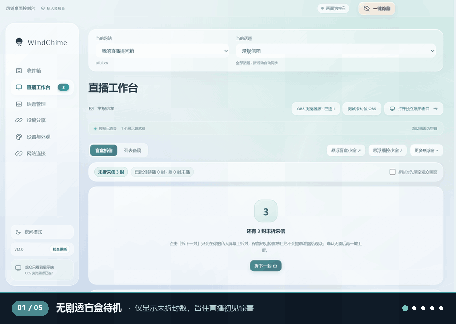
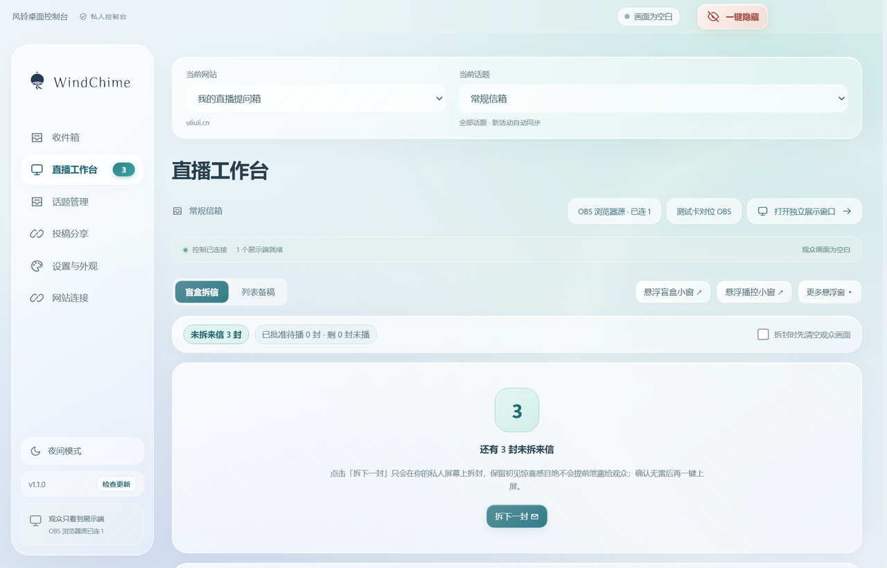
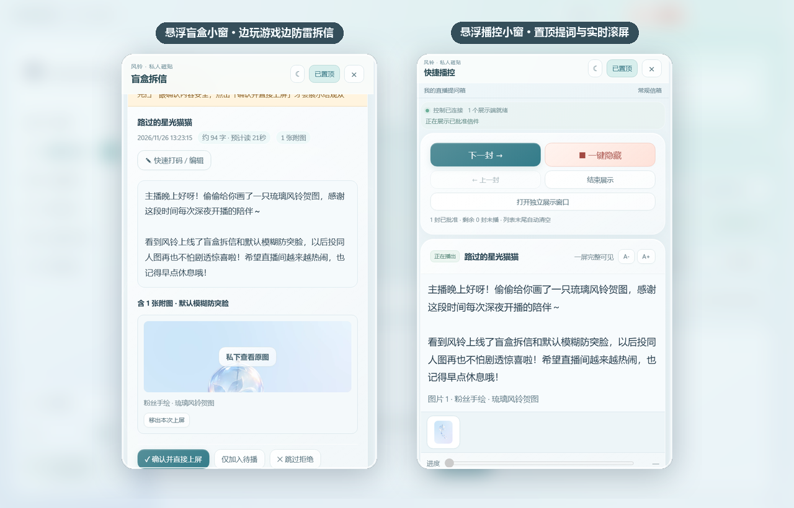
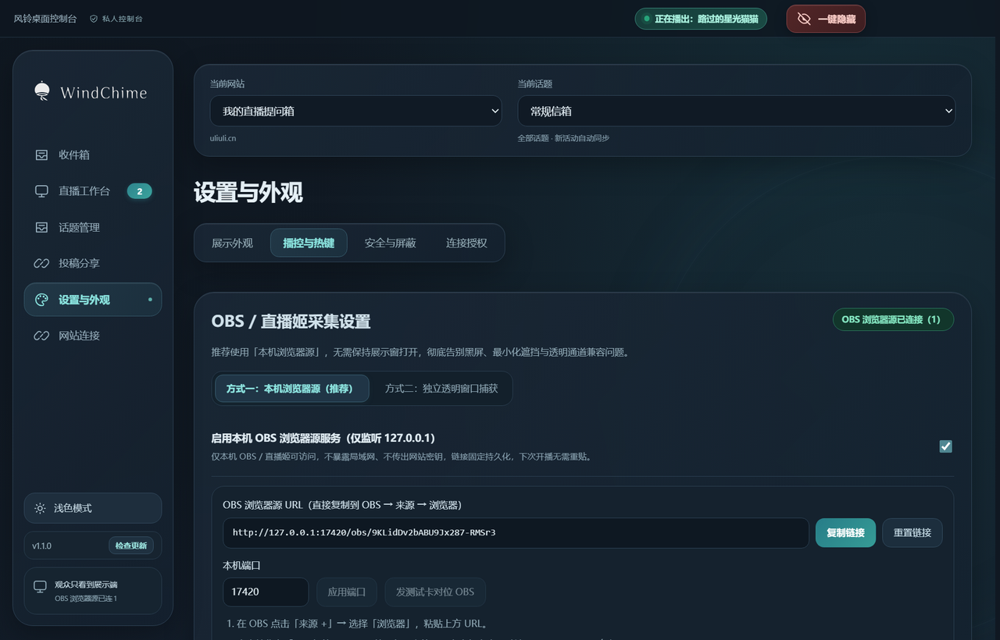
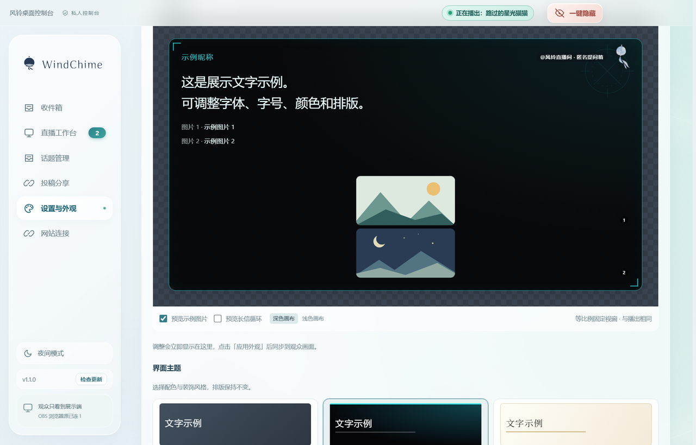

<picture>
  <source media="(prefers-color-scheme: dark)" srcset="assets/readme/banner-dark.png" />
  <source media="(prefers-color-scheme: light)" srcset="assets/readme/banner-light.png" />
  
</picture>

 
 

<h3>专为独立主播打造的匿名提问箱与直播播控台</h3>

留住直播初见读信的真实惊喜感，把恶意文字与突脸图片稳稳拦在上屏之前。

  
  
  
  
  

 

  
  &nbsp;&nbsp;
  

  <a href="#效果演示">效果演示</a> ·
  <a href="#界面预览">界面预览</a> ·
  <a href="#三步快速开播">三步快速开播</a> ·
  <a href="#核心功能">核心功能</a> ·
  <a href="#常见问题">常见问题</a>

---

## 效果演示

盲盒无剧透待机 → 私人拆信（附图默认模糊防突脸）→ 私下核验原图 → 一键上屏提词同步 → 浅色 / 夜间双外观

> [!TIP]
> **更新与安装提示**
> - **国内直连免翻墙**：点击上方绿色按钮即可直接下载最新版 Windows 安装程序；从 `1.1.0` 起内置国内直连自动更新（Ed25519 数字签名 + SHA-256 校验），新版发布后自动提醒并支持应用内一键升级，且**绝不在直播途中打断或重启**。
> - **无损覆盖升级**：旧版用户直接运行新安装包覆盖即可，已连接的网站密钥、热键、外观与本地配置都会完整保留。
> - **首次安装提示**：若 Windows SmartScreen 弹出「Windows 已保护你的电脑」，点击 **「更多信息 → 仍要运行」** 即可继续安装。

---

## 界面预览

<table>
  <tr>
    <td width="50%" valign="top">
      
       
      <strong>浅色液态玻璃工作台</strong> 
      默认无剧透盲盒待机，仅提示未拆来信数与展示端在线状态，保留直播初见惊喜。
    </td>
    <td width="50%" valign="top">
      
       
      <strong>置顶悬浮盲盒 &amp; 播控小窗</strong> 
      打游戏或画画时把主窗口收到托盘，屏幕角落挂起小窗即可单手拆信、防雷、上屏与控滚。
    </td>
  </tr>
  <tr>
    <td width="50%" valign="top">
      
       
      <strong>本机 OBS 浏览器源 &amp; 夜间模式</strong> 
      一键开启本机浏览器源并复制地址粘贴到 OBS，无需常开展示窗口，彻底告别黑屏与遮挡。
    </td>
    <td width="50%" valign="top">
      
       
      <strong>多套外观主题 &amp; 本机专属水印</strong> 
      自由切换排版与主题配色，支持纯本机叠加专属 Q 版角标、频道文字水印与半透明底图。
    </td>
  </tr>
</table>

---

## 三步快速开播

1. **连接你的提问箱**  
   打开提问箱网页后台（`/mail`），生成一个「站点连接密钥」粘贴到风铃桌面端即可。全部话题自动同步，凭据经 Windows 系统加密保存在本机，无需反复登录。
2. **接入 OBS / 直播姬**  
   在「直播工作台」点开 **「OBS 采集设置」**：
   - **本机浏览器源（推荐）**：一键启用后复制固定本机地址，粘贴到 OBS「来源 → 浏览器」即可，下次开播无需重贴。
   - **独立透明窗口（兼容方式）**：点击「打开独立展示窗口」，在 OBS 添加「窗口捕获」选择 `WindChime Display`。
   - 点一下 **「测试卡对位 OBS」** 即可在画面里实时拖放位置与尺寸，不会写入任何真实来信。
3. **盲盒拆信 &amp; 安心上屏**  
   点 **「拆下一封」** 只在你的私人屏幕拆开，所有附图**默认高斯模糊防突脸**；看一眼确认安全后点 **「确认并直接上屏」** 观众端才会展示，遇到恶意来信直接 **「跳过拒绝」** 或 **「拒收并拉黑」**。直播中随时按 **`Ctrl + Shift + H`** 即可一键清屏。

---

## 核心功能

| 场景 | 风铃为你准备了什么 |
| :--- | :--- |
| **单人开播防雷** | 默认「盲盒拆信」模式（无剧透待机 + 附图默认模糊 + 快速打码/移出图片 + 一键拒收拉黑），也可随时切回「列表备稿」批量审核排序 |
| **边播边拆不断节奏** | 支持独立置顶的「悬浮盲盒小窗」与「悬浮播控小窗」，配合全局快捷键与托盘驻留，画画、打游戏也能单手控场 |
| **长信丝滑读稿** | 在播提词器与观众端 1:1 实时同步滚动，支持鼠标滚轮、进度条拖拽、提词字号放大、大图灯箱预览及自定义滚动热键 |
| **省心 OBS 接入** | 内置本机回环 OBS 浏览器源（不暴露局域网、不传出密钥），兼顾独立透明窗口捕获与一键测试卡对位 |
| **专属直播视觉** | 内置 6 种卡片排版 × 3 套主题（纯净 / UliUli 夜航 / Mia 星祷），并支持纯本机叠加自定义角标、频道水印与背景叠图 |
| **全套信箱与复盘** | 收件箱检索/收藏/一键直批、多话题管理与归档、投稿二维码与海报生成、黑名单与违禁词、本场读信时间轴与 Markdown/CSV 复盘导出 |
| **国内直连自动更新** | 应用内定期静默检查更新，安装包经过 Ed25519 数字签名与 SHA-256 双重校验，支持断点续传与一键安装 |

---

## 常见问题

<strong>更新桌面端需要同步升级网站服务器吗？</strong>

 
不需要。只要提问箱网站已部署兼容版本，桌面端的所有播控、盲盒、OBS 浏览器源、自定义水印和国内直连自动更新功能都可以独立升级使用。

<strong>新来信提示音会串进直播间吗？</strong>

 
不会。风铃提示音默认关闭；即使你主动开启，也只在主播私人控制台播放，独立展示窗口与 OBS 浏览器源永远保持静音。

<strong>点击窗口右上角关闭按钮会直接退出吗？</strong>

 
默认会最小化到系统托盘，保持全局热键和 OBS 浏览器源持续可用；需要完全退出时，右键右下角系统托盘图标选择「退出并结束展示」即可。

<strong>自定义角标和频道水印会上传到外部服务器吗？</strong>

 
不会。所有本机装饰图片与文字水印都只保存在你的电脑本地，不上传到网站，并实时同步生效于独立展示窗口与本机 OBS 浏览器源。

---

## 开发者与更多文档

如果你希望将风铃匿名信箱库（`@windchime/embed`）集成到自己的 Next.js 网站，或从源码构建与参与开发，请参阅：

- [桌面端详细使用指南与源码构建](apps/desktop/README.md)
- [网站集成指南（`@windchime/embed` / Next.js + SQLite）](docs/EMBED.md)
- [更新日志（Changelog）](CHANGELOG.md)
- [开源许可与第三方组件声明](docs/LICENSES.md)（MIT License）
